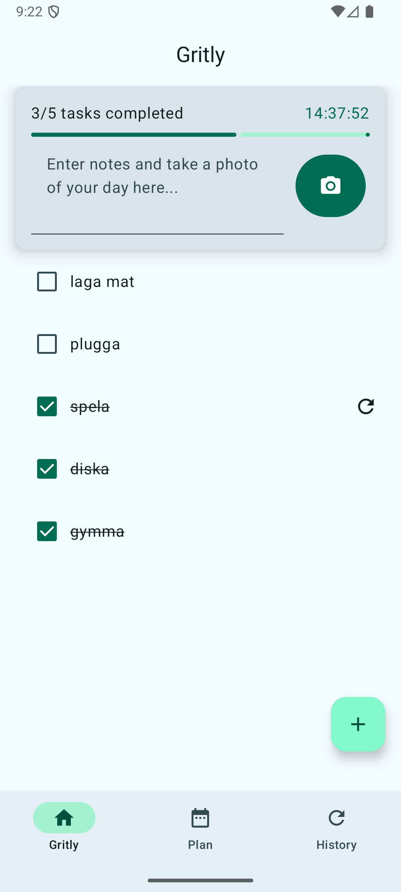
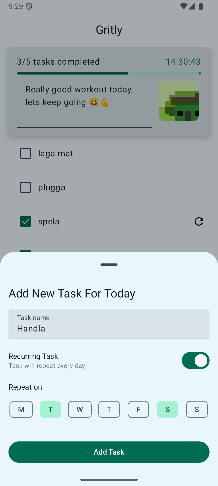
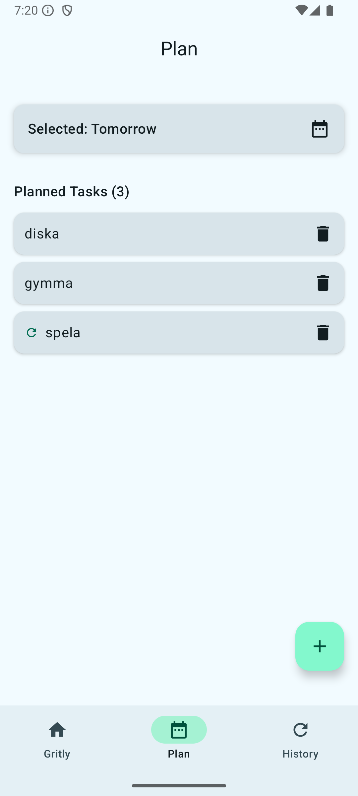
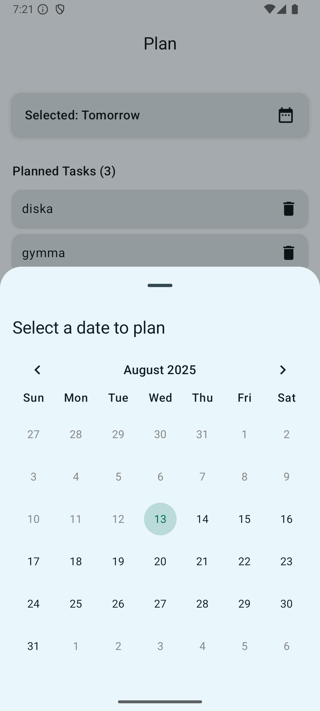
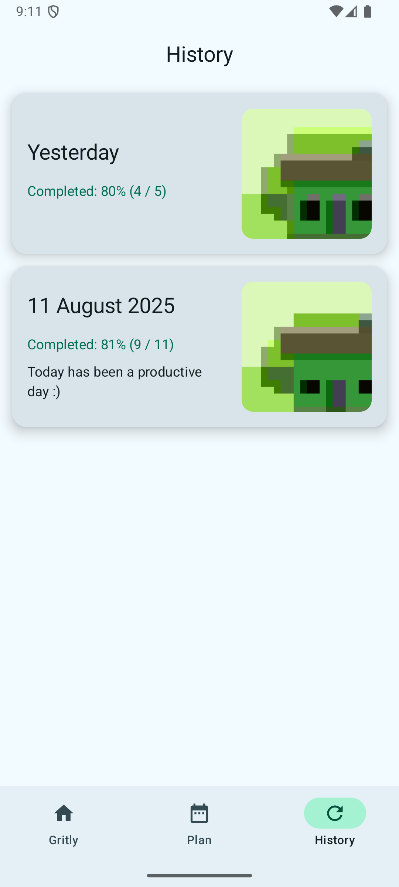
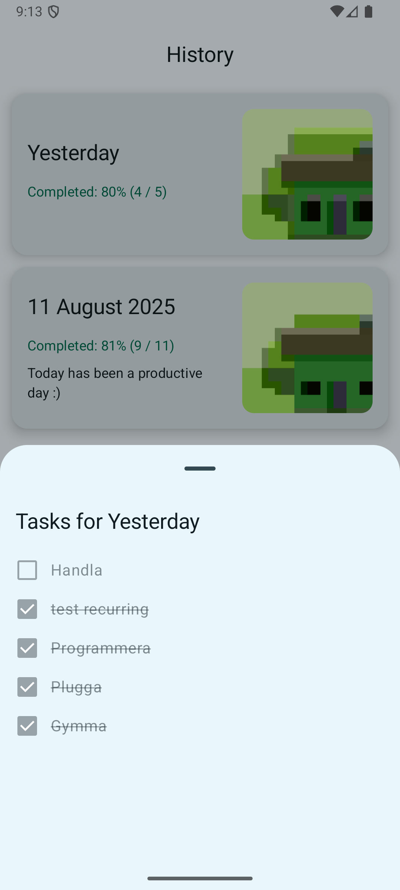

# Gritly

Gritly is an Android mobile application designed to help users build good habits, organize daily tasks, and maintain structure in their everyday lives. It allows users to plan tasks (one-time or recurring), mark them as completed, track progress with a visual progress bar, add daily notes, and capture photos for personal reflection. The app also includes a history view to review past days, acting like a digital journal for self-reflection and motivation.

This app was developed as part of a university course project. It targets users of all ages who want to improve productivity and routine management, from teenagers organizing chores to adults handling work and errands.

## Features

- **Task Planning**: Create one-time tasks for specific dates or recurring tasks for selected weekdays. Planning is restricted to future dates to encourage proactive scheduling.
- **Home View**: Displays today's tasks with a progress bar showing completion percentage and a countdown timer for the day. Users can mark tasks as done, add short daily notes, and take photos.
- **Planning View**: Select a future date via a calendar picker to add or edit tasks. Recurring tasks are indicated with icons.
- **History View**: Overview of past days with completion statistics, notes, photos, and a list of completed/incomplete tasks. Tap a day card for details (non-interactive).
- **Local Storage**: All data (tasks, notes, photos) is stored securely on the device using Room database—no cloud backend or third-party data sharing.
- **Ethics and Security**: Follows Android best practices for file handling and permissions (e.g., camera access only). No manipulative features; focuses on positive habit-building.
- **UI/UX**: Built with Jetpack Compose for a modern, responsive interface following Material Design 3. Adapts to light/dark themes and user color preferences.
- **Calendar Component**: Uses the open-source [Calendar library](https://github.com/kizitonwose/Calendar) for date selection, customized to disable past and current dates.

## Requirements

- Android device running API level 21 (Lollipop) or higher.
- Kotlin 1.8+ (as the app is written in Kotlin).
- Dependencies (managed via Gradle):
  - Jetpack Compose
  - Room Database
  - Lifecycle and ViewModel components
  - External: kizitonwose/Calendar (for calendar UI)

## Installation

1. Clone the repository:
   ```sh
   git clone https://github.com/jonatanwestling/gritly.git
   ```
2. Open the project in Android Studio.
3. Sync Gradle dependencies.
4. Build and run the app on an emulator or physical device.

No APK is provided in this README; build it from source for testing.

## Usage

Follow these steps to get started:

1. **Plan Tasks**: On the Home or Planning view, tap the "+" floating action button. Enter a task title, optional description, and choose if it's recurring (select weekdays). In Planning view, use the calendar to pick a future date.
2. **Complete Tasks**: In the Home view, tap a task to mark it as done. Completed tasks move to the bottom of the list, and the progress bar updates.
3. **Add Daily Notes and Photos**: In the Home view, enter text in the note field or tap the camera button to capture a photo for the day.
4. **View History**: Navigate to the History view via the bottom navigation bar. Scroll through past days, see completion stats, notes, and photos. Tap a day card for a detailed task list (non-interactive).

The app encourages planning ahead—tasks for today can only be added/edited in the Home view, while future planning happens in the Planning view.

## Architecture

Gritly follows the MVVM (Model-View-ViewModel) architecture for clear separation of concerns:

- **Model Layer**: Data classes (`Task`, `RecurringTask`, `DailyEntry`) stored in Room database. DAOs (`TaskDao`, `RecurringTaskDao`, `DailyEntryDao`) handle CRUD operations. Repositories (`TaskRepository`, `DailyEntryRepository`) abstract data access.
- **ViewModel Layer**: `TaskViewModel` manages task logic (creation, updates, filtering). `DailyViewModel` handles notes, photos, and file management. Uses LiveData for reactive UI updates.
- **View Layer**: Composable functions for screens (Home, Planning, History). Navigation via NavHost/NavController. States managed with `remember` and `rememberSaveable`.

Database is initialized as a singleton in `DatabaseProvider` to ensure a single instance across ViewModels.

## Screenshots


### Home View

<p align="center">
  
  
</p>

### Planning View

<p align="center">
  
  
</p>

### History View

<p align="center">
  
  
</p>

## Potential Improvements

- Split ViewModels further (e.g., one per screen).
- Add edit/delete confirmations and weekday editing for recurring tasks.
- Include statistics (e.g., total tasks, trends, graphs).
- Implement dependency injection for better modularity.
- Refactor Composables into smaller, reusable components.

## License

This project is open-source under the MIT License. 
## References

- [Guide to App Architecture](https://developer.android.com/topic/architecture#data-layer)
- [Calendar Library](https://github.com/kizitonwose/Calendar)

Developed by Jonatan Westling, September 2025.